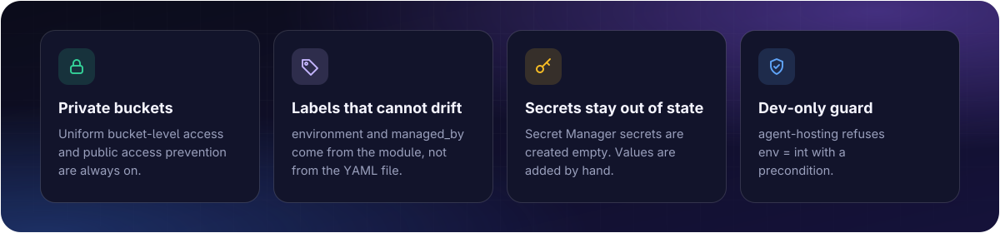

<p align="center"></p>

Reusable Terraform modules for the [`infrastructure-terraform-gcp`](https://github.com/sinex-cloud/infrastructure-terraform-gcp) platform. It consumes them by git tag. Nothing in this repo is applied directly.

## How it works

<p align="center"></p>

## Try it offline

Real output of `terraform plan`, with no GCP account and a placeholder access token. The error on `-var env=int` is expected, because `agent-hosting` only deploys to `dev`.

<p align="center"></p>

<details>
<summary><b>Run the plans yourself</b></summary>

Make two empty folders, `data-platform/` and `agent-hosting/`. The placeholder token is enough for these plans.

`data-platform/main.tf`:

```hcl
provider "google" {
  project      = "demo-project"
  region       = "europe-west1"
  access_token = "offline-demo"
}

module "data_platform" {
  source                      = "git::https://github.com/sinex-cloud/gcp-foundation-module.git?ref=v0.3.9"
  path_to_yaml_resources_file = "${path.module}/foundation.yaml"
  env                         = "dev"
  project                     = "demo-project"
}

output "dataset_ids" { value = module.data_platform.dataset_ids }
output "bucket_names" { value = module.data_platform.bucket_names }
```

`data-platform/foundation.yaml`:

```yaml
version: 1.0

labels:
  platform: data-platform
  owner: data-engineering
  application: infra-review
  data_classification: internal

additional_project_permissions:
  - role: bigquery.jobUser
    environments: [dev]
    members:
      users: [someone@example.com]

managed_datasets:
  platform_analytics:
    location: europe-west1
    environments: [dev, int]
    permissions:
      - role: bigquery.dataViewer
        members:
          users: [someone@example.com]

buckets:
  raw-data:
    location: europe-west1
    environments: [dev, int]
    permissions:
      - role: storage.objectViewer
        members:
          users: [someone@example.com]
```

`agent-hosting/main.tf`:

```hcl
variable "env" {
  type = string
}

provider "google" {
  project      = "demo-project"
  region       = "europe-west1"
  access_token = "offline-demo"
}

module "agent_hosting" {
  source  = "git::https://github.com/sinex-cloud/gcp-foundation-module.git//agent-hosting?ref=v0.3.9"
  env     = var.env
  project = "demo-project"
  region  = "europe-west1"
}
```

Then run:

```bash
cd data-platform
terraform init
terraform plan                    # Plan: 5 to add, 0 to change, 0 to destroy.

cd ../agent-hosting
terraform init
terraform plan -var env=dev       # Plan: 28 to add, 0 to change, 0 to destroy.
terraform plan -var env=int       # Error: Resource precondition failed
```

</details>

## Built in

<p align="center"></p>

## Modules

### Root module: data platform

Creates BigQuery datasets, Cloud Storage buckets and IAM members at project, dataset and bucket level. All of it comes from a `foundation.yaml` file. Datasets, buckets and project grants only apply to the environments they list. The consuming repo's `foundation-config/foundation.yaml` shows the schema in practice: datasets under `managed_datasets`, buckets under `buckets` and project-level grants under `additional_project_permissions`.

| Variable | Description |
|---|---|
| `path_to_yaml_resources_file` | Path to the environment's `foundation.yaml` |
| `env` | `dev` or `int` |
| `project` | GCP project ID |

Outputs: `dataset_ids` and `bucket_names`, both keyed by name. Bucket names are `<project>-<key>`.

### agent-hosting

The infrastructure the review and apply agent runs on: a Cloud Run service, three service accounts with their IAM bindings, three Secret Manager secrets, an Artifact Registry repo, a bucket for review artifacts and the Cloud Build connection to GitHub. It only deploys to `dev`, because a `lifecycle.precondition` rejects any other environment.

| Variable | Description |
|---|---|
| `env` | `dev` or `int` (only `dev` currently passes the precondition) |
| `project` | GCP project ID |
| `region` | Region for Cloud Run, Artifact Registry and the review artifacts bucket |

## Usage

The other repo consumes both modules by tag from its root `main.tf`:

```hcl
module "data_platform" {
  source                      = "git::https://github.com/sinex-cloud/gcp-foundation-module.git?ref=vX.Y.Z"
  path_to_yaml_resources_file = "${path.module}/foundation-config/foundation.yaml"
  env                         = var.env
  project                     = var.project
}

module "agent_hosting" {
  source  = "git::https://github.com/sinex-cloud/gcp-foundation-module.git//agent-hosting?ref=vX.Y.Z"
  env     = var.env
  project = var.project
  region  = "europe-west1"
}
```

Each path (the root and `agent-hosting/`) is versioned and pinned on its own, so the two modules can sit on different tags in the consuming repo at the same time.

## Releasing

After a change lands on `main`, tag it as `vMAJOR.MINOR.PATCH`. The consuming repo bumps its `?ref=` once the tag exists. No CI publishes releases, so tagging is manual.

## Things to know

- Every bucket these modules create has `force_destroy = true`. Destroying a bucket also deletes the objects in it.
- IAM is granted with `*_iam_member` resources. They add one member at a time and leave other members alone.
- The agent's Cloud Run service accepts unauthenticated calls, because GitHub webhooks cannot carry a Google identity token. The agent service checks the webhook signature instead.
- Terraform ignores changes to the Cloud Run container image. The module sets a placeholder, and the real image is deployed outside Terraform.
- This repo has no tests and no CI yet.
